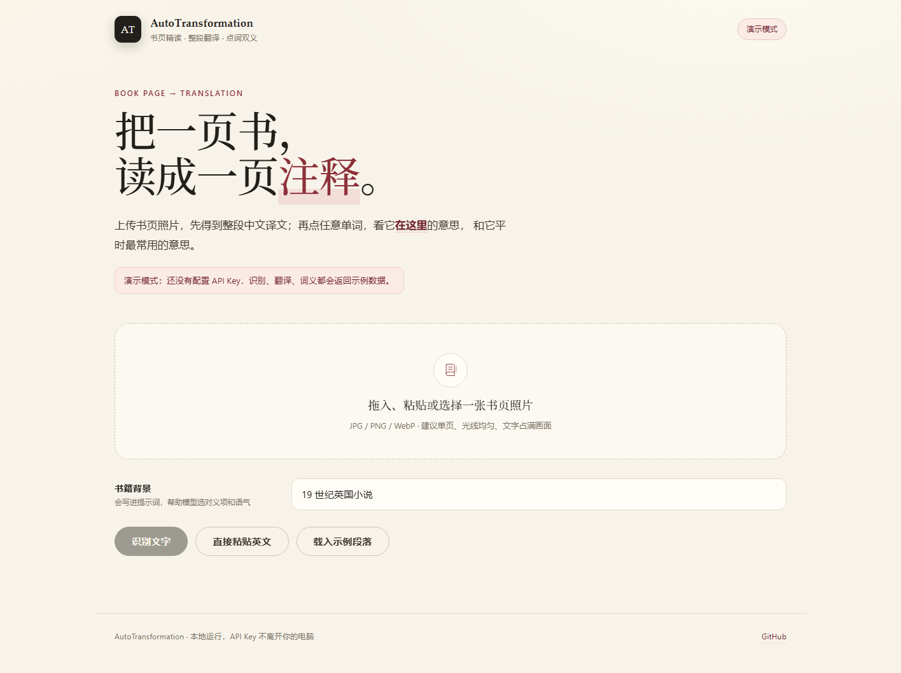
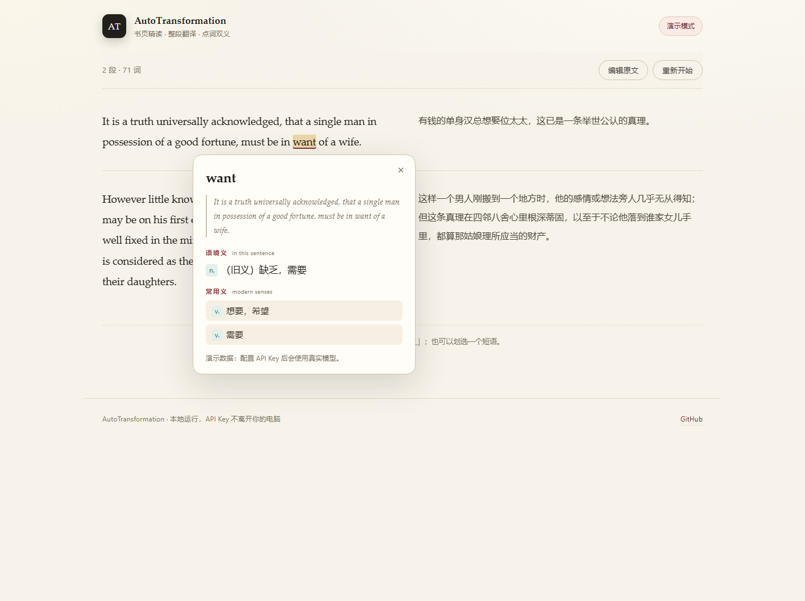

# AutoTransformation

**上传一张书页照片，得到整段中文译文；再点任意单词，看它在这里的意思，和它平时最常用的意思。**





<p>
  <a href="https://github.com/zzz0418c/AutoTransformation/actions/workflows/test.yml"></a>
  
  
</p>

---

## 这是什么

一个本地运行的网页小工具，只做三件事：

1. **图片 → 文字**：上传（或直接粘贴）一张英文书页照片，用支持图片输入的视觉模型转录成英文，保留段落。
2. **文字 → 译文**：逐段翻译成简体中文，左右对照，段落一一对齐。
3. **点词 → 双义**：在原文里点任意单词，弹出「**语境义**」（它在这句话里的意思）和「**常用义**」（现代英语里最常见的几个义项）。也可以划选一个短语。

读《傲慢与偏见》这类旧小说时，真正卡住人的往往不是生词，而是 `want`（缺乏）、`let`（阻挡）、`nice`（精细的）这种“熟词旧义”。所以点词卡片会把语境义放在前面，并在需要时标出「（旧义）」。

## 它不做什么

刻意保持很小，以下功能**没有**实现：

- 不自动挑“难词 / 偏词”，也不做生词本、记忆卡、间隔复习；
- 不做 PDF 批注、整本书翻译、发音、导出；
- 不内置词典：两个义项都由你配置的大模型生成。

你点哪个词，就解释哪个词——判断权留给你。

## 和 ReadBuddy 的关系

灵感来自 [ReadBuddy](https://github.com/RichardLoZC/ReadBuddy) 的“拍照 → 按语境理解单词”思路，但**没有复用它的任何代码**，也不是 fork：

| | ReadBuddy | AutoTransformation |
|---|---|---|
| 形态 | Electron 桌面应用 | 浏览器 + 本地 Node 服务 |
| 输入 | 书页照片 | 书页照片 / 粘贴文本 |
| 主线 | 按词汇水平**预先标注**生词 | 先给**整段译文**，再按需点词 |
| 词义 | 常见义 + 文中义 | 语境义 + 常用义 |
| 额外 | 等级校准、生词本、PDF 导出 | 校对原文、划选短语 |

## 快速开始

需要 **Node.js 20+**（Windows / macOS / Linux 均可）。

```bash
git clone https://github.com/zzz0418c/AutoTransformation.git
cd AutoTransformation

npm install
cp .env.example .env      # Windows: copy .env.example .env
# 打开 .env，填入下面的配置
npm start
```

然后打开 <http://127.0.0.1:8787>。

**没有 API Key 也能先跑起来**：不填 `.env` 直接 `npm start`，会进入「演示模式」，识别、翻译、词义都返回内置示例数据，界面和交互完全可用。

## 配置

把 `.env.example` 复制成 `.env`。文本模型负责翻译和词义，视觉模型负责图片转录；两者都走 OpenAI 兼容的 `/chat/completions`。

| 变量 | 默认值 | 说明 |
|---|---|---|
| `LLM_API_KEY` | 空 | 文本模型 Key。为空则进入演示模式 |
| `LLM_BASE_URL` | `https://api.deepseek.com/v1` | 文本模型接口地址 |
| `LLM_MODEL` | `deepseek-chat` | 文本模型名 |
| `VISION_API_KEY` | 复用 `LLM_API_KEY` | 视觉模型 Key |
| `VISION_BASE_URL` | 复用 `LLM_BASE_URL` | 视觉模型接口地址 |
| `VISION_MODEL` | 复用 `LLM_MODEL` | 视觉模型名，**必须支持图片输入** |
| `BOOK_CONTEXT` | `19 世纪英国小说` | 写进提示词的书籍背景，也可在页面上临时改 |
| `PORT` | `8787` | 本地端口 |
| `HOST` | `127.0.0.1` | 只监听本机；不要随意改成 `0.0.0.0` |
| `LLM_TIMEOUT_MS` | `90000` | 单次模型请求超时 |
| `MAX_UPLOAD_MB` | `12` | 图片大小上限 |
| `LLM_MOCK` | `0` | 设为 `1` 强制演示模式 |

### 例 A：文本用 DeepSeek，图片用另一家视觉模型

DeepSeek 的文本接口便宜、中文稳，但不一定提供图片输入；这时把视觉部分单独指到别家：

```dotenv
LLM_API_KEY=sk-你的DeepSeekKey
LLM_BASE_URL=https://api.deepseek.com/v1
LLM_MODEL=deepseek-chat

VISION_API_KEY=你的视觉模型Key
VISION_BASE_URL=https://open.bigmodel.cn/api/paas/v4
VISION_MODEL=你账号里可用的视觉模型
```

### 例 B：一个服务全包

如果同一家同时提供文本和视觉模型，只填 `LLM_*`，并把 `LLM_MODEL` 设成支持图片的模型即可（`VISION_*` 留空会自动复用）。

也可以用本机的 Ollama 等 OpenAI 兼容网关，把 `LLM_BASE_URL` 指到 `http://127.0.0.1:11434/v1`。

## 怎么用

1. **上传**：拖入、`Ctrl+V` 粘贴，或点击选择一张书页照片。图片会在浏览器里缩到最长边 1600px 再上传。
2. **校对**：OCR 难免有错，识别结果会先放进文本框，改完再点「翻译这段」。段落之间空一行。
3. **阅读**：左边英文、右边中文。点任意单词看卡片；划选一个短语也可以。点「编辑原文」可以回去改字。

拍照建议：单页、尽量铺平、光线均匀、文字占满画面。两页摊开或手指压页会明显降低识别率。

## 工作原理

```text
图片 ──► 视觉模型转录（保留段落）
          │
          ▼
      浏览器里可编辑的英文
          │
          ▼
      文本模型逐段翻译（带段落 id，保证左右对齐）
          │
          ▼
      英文逐词包成 <span> ──点击──► 文本模型按「词 + 所在句 + 整段」判断义项
```

几个有意的设计：

- **按段翻译、按 id 对齐**：一次请求翻一小批段落，模型返回 `{id, text}`；缺 id 会重试，仍失败就逐段兜底，避免整页因为一个格式错误全丢。
- **词义只看这一句**：提示词要求“语境义必须是这句话里实际用到的义项”，并明确允许标注旧义/文学义；常用义则要求是现代英语的高频义项，且不与语境义重复。
- **原文可校对**：OCR 不是可信输入，先把文本交给你改，再翻译。
- **密钥只在服务端**：浏览器拿不到 Key，也不会把 Key 写进 localStorage。

### API

| 方法 | 路径 | 请求 | 返回 |
|---|---|---|---|
| `GET` | `/api/config` | — | 是否演示模式、模型名、上传上限 |
| `POST` | `/api/ocr` | `multipart/form-data`：`image`、`context` | `{ text }` |
| `POST` | `/api/translate` | JSON：`text`、`context` | `{ paragraphs: [{ id, source, translation }] }` |
| `POST` | `/api/word` | JSON：`word`、`sentence`、`paragraph`、`context` | `{ word, lemma, contextual, common[] }` |

单张图片上限 12 MB，单次翻译上限 20000 字符；服务只监听 `127.0.0.1`。

## 项目结构

```text
server/
  app.js          Express 路由、上传校验、错误处理
  llm.js          OpenAI 兼容客户端 + 演示模式数据
  prompts.js      转录 / 翻译 / 词义三组提示词
  config.js       .env 读取与默认值
  lib/text.js     分段、分块、硬换行合并
  lib/json.js     从模型输出里提取 JSON
  lib/errors.js   可安全返回给前端的错误类型
public/
  index.html      三步式界面
  app.js          上传、翻译、点词、卡片定位
  styles.css      纸张质感排版
  js/text.js      分词与句子边界（前端和测试共用）
  js/sample.js    示例段落
tests/            node:test 单元测试与接口测试
```

## 测试

```bash
npm test
```

覆盖分段/硬换行合并、JSON 提取、分词偏移、缩写句界，以及 OCR / 翻译 / 点词三条接口的成功与失败路径。CI 在 GitHub Actions 上跑同一套测试。

## 隐私

- 图片只发送给你在 `.env` 里配置的模型服务，不经过任何第三方中转。
- 服务端不落盘：图片在内存里转成 base64 发走，随后丢弃；译文只存在浏览器内存中。
- API Key 只存在 `.env`，`.env` 已被 `.gitignore` 忽略；接口不会把 Key 返回给前端。

## 已知限制

- 花体、手写、严重倾斜、两页跨页的照片识别率会明显下降；识别结果需要你校对。
- 词义由大模型生成，偶发不准确；同一词在不同句子里结果可能不同，这是刻意的（语境优先）。
- 长文本需要自己分段，单次上限 20000 字符。
- 只支持 JPG / PNG / WebP，不支持 PDF 直接导入。

## Roadmap

- [ ] PDF 导入（先渲染成图片再走现有链路）
- [ ] 多页批量识别与连续翻译
- [ ] 导出双语 HTML / Markdown
- [ ] 可选的本地 OCR 兜底（Tesseract / Windows OCR）

## License

[MIT](LICENSE) © 2026 zzz0418c

书页示例文字取自公有领域的《傲慢与偏见》；示例译文为本项目自写，未使用任何受版权保护的译本。
