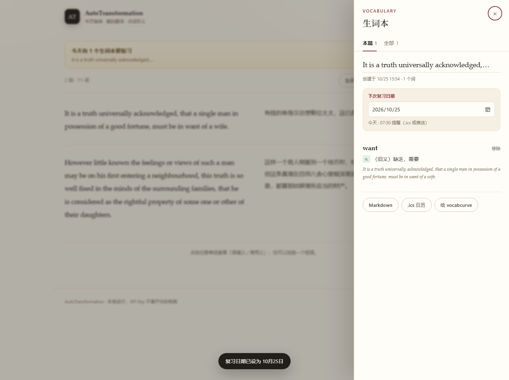
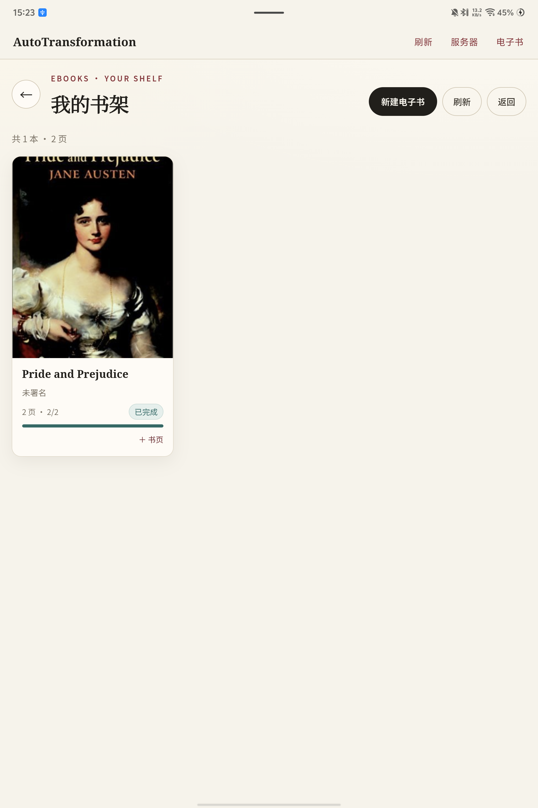
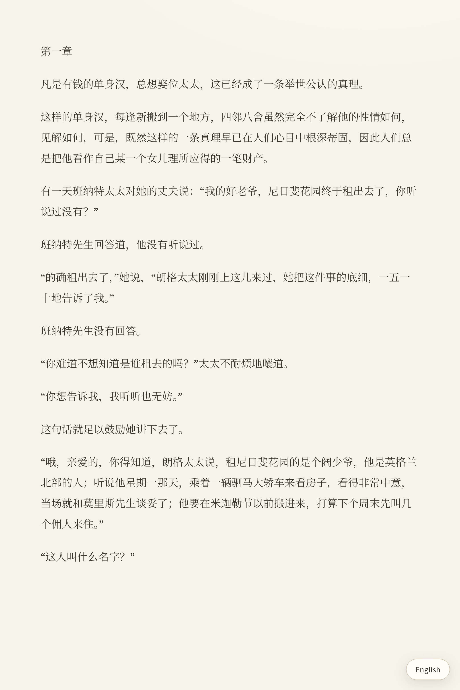
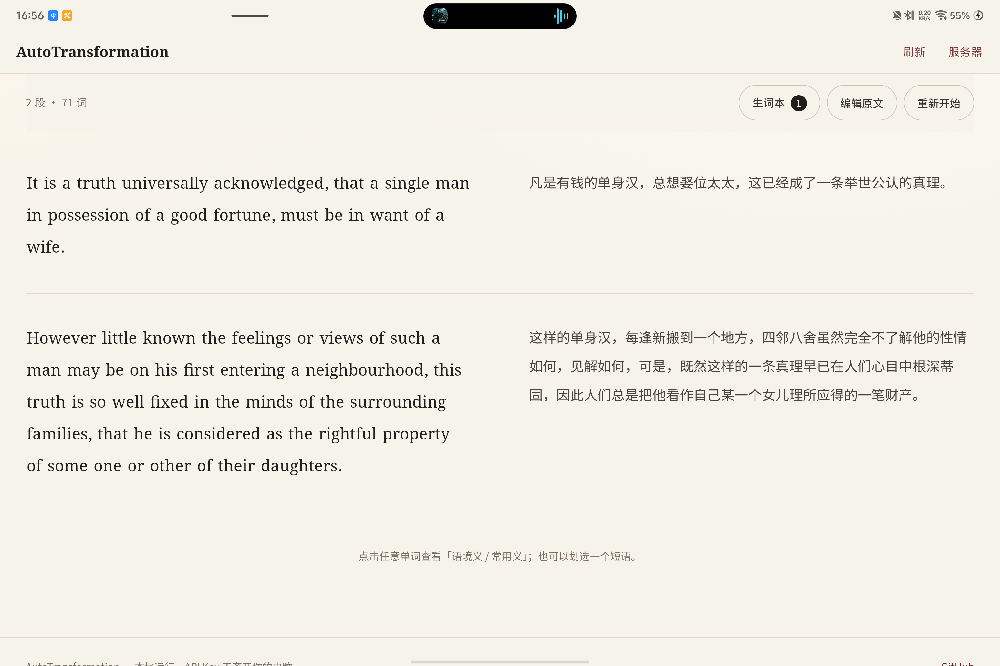
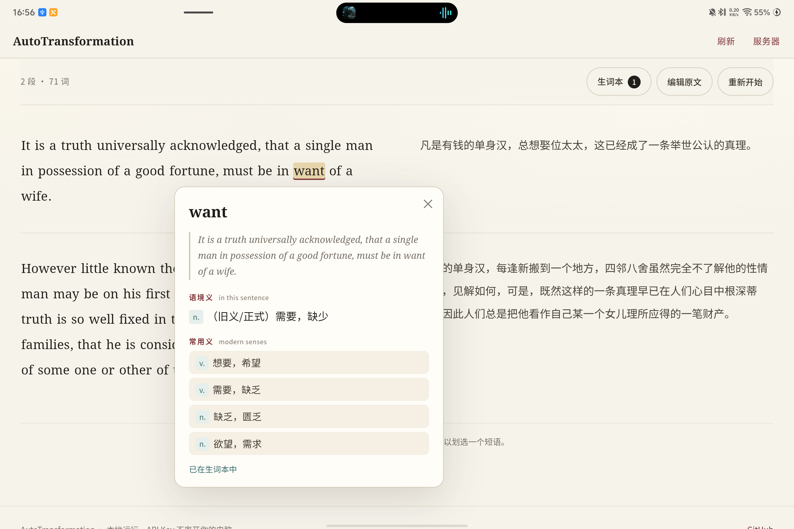

# AutoTransformation

**上传一张书页照片，得到整段中文译文；点任意单词看「语境义 / 常用义」；点过的词自动变成这一篇的生词本，到复习日期提醒你。**




<p>
  <a href="https://github.com/zzz0418c/AutoTransformation/actions/workflows/test.yml"></a>
  
  
</p>

---

## 这是什么

一个本地运行的网页小工具，做四件事：

1. **图片 → 文字**：上传（或直接粘贴）一张英文书页照片，用支持图片输入的视觉模型转录成英文，保留段落。
2. **文字 → 译文**：逐段翻译成简体中文，左右对照，段落一一对齐。
3. **点词 → 双义**：在原文里点单词或划选短语，弹出「**语境义**」（它在这句话里的意思）和「**常用义**」（现代英语里最常见的几个义项）。
4. **点过的词 → 生词本**：自动收进当前这一篇的生词本；选一个「下次复习日期」，到期用日历或微信提醒。

读《傲慢与偏见》这类旧小说时，真正卡住人的往往不是生词，而是 `want`（缺乏）、`let`（阻挡）、`nice`（精细的）这种“熟词旧义”。点词卡片会把语境义放在前面，并在需要时标出「（旧义）」。

## 电子书：整本导入

右上角「电子书」是独立书架，不影响原来的单页流程。

1. **新建电子书**：填书名、作者、书籍背景，一次选多张书页图片；也可以先建空书，之后再补。
2. **按顺序逐页处理**：上传的图片进入服务端队列，一页一页做 OCR 和翻译，不会同时打满模型接口。
3. **书架与封面**：显示封面、页数、已翻译进度；新建时按书名从 Douban 匹配真实封面并保存到服务器，匹配不到时生成一张带书名/作者的排版封面；翻译中的书会自动刷新。
4. **全屏阅读器**：只显示从图片里提取的英文，不显示原图、页码或其他栏；页面**不上下滚动**，按屏幕高度自动放大字号，装不下的文字接到下一屏；每张新书页另起一屏，`Chapter 1` 这类篇章页也直接另起一屏。
5. **语言切换不丢位置**：右下角「中文」按钮切到译文，再按「English」切回英文；切换后停留在当前书页的对应位置，不会跳回本页开头。左右滑动翻页，翻页带 3D 书页翻转动画，自动记住上次读到哪一页。
6. **继续导入**：书架卡片上的「＋ 书页」可以继续拍下一批；失败页会在阅读器里给出重试按钮，整本处理完显示「已完成」。
7. **删除**：书架卡片上删除，会同时清理书页原图和翻译数据。

电子书数据保存在服务端 `data/ebooks.json`，原图在 `data/ebooks/<bookId>/`；仍然使用同一套模型配置和 API Key。






## 第一次使用：你要做的

1. **填配置**：把 `.env.example` 复制成 `.env`，填入模型 Key。推荐 DeepSeek Flash：一个 Key、一个模型同时管文字和图片。
2. **启动**：`npm start`，打开 <http://127.0.0.1:8787>。
3. **读一页**：上传书页 → 校对识别结果 → 翻译。
4. **收词**：点几个你想记的词；右侧「生词本」里改标题、选「下次复习日期」。
5. **选提醒方式**（二选一即可）：
   - **日历（推荐，电脑关机也能提醒）**：生词本里点「.ics 日历」，把文件导入手机/平板日历。
   - **微信推送**：把 vocabcurve 里 `notify.cmd` 那个企业微信 webhook 填到 `.env` 的 `PUSH_URL`，先 `npm run notify -- --dry-run` 看内容，再按需安装 Windows 计划任务。

没有 API Key 也能 `npm start`，会进入演示模式，界面、生词本、提醒都能试。

## 它不做什么

刻意保持很小：

- **不自动挑“难词 / 偏词”**：只收你主动点过的词，判断权留给你。
- **不做间隔重复算法**：每篇只有一个「下次复习日期」，到期提醒一次；复习完自己改下一次日期。
- **不做 PDF 批注、发音、等级校准、记忆卡**。
- **不内置词典**：两个义项都由你配置的大模型生成。

## 和 ReadBuddy 的关系

灵感来自 [ReadBuddy](https://github.com/RichardLoZC/ReadBuddy) 的“拍照 → 按语境理解单词”思路，但**没有复用它的任何代码**，也不是 fork：

| | ReadBuddy | AutoTransformation |
|---|---|---|
| 形态 | Electron 桌面应用 | 浏览器 + 本地 Node 服务 |
| 输入 | 书页照片 | 书页照片 / 粘贴文本 |
| 主线 | 按词汇水平**预先标注**生词 | 先给**整段译文**，再按需点词 |
| 词义 | 常见义 + 文中义 | 语境义 + 常用义 |
| 生词本 | 有 | **每次翻译一篇，点词自动收录** |
| 额外 | 等级校准、PDF 导出 | 复习日期、日历 / 微信提醒、vocabcurve 导出 |

## 快速开始

需要 **Node.js 20+**（Windows / macOS / Linux 均可）。

```bash
git clone https://github.com/zzz0418c/AutoTransformation.git
cd AutoTransformation

npm install
cp .env.example .env      # Windows: copy .env.example .env
# 打开 .env，填入下面的配置
npm start
```

然后打开 <http://127.0.0.1:8787>。

## 装成桌面 App（不用 Electron）

Windows 上执行一次：

```powershell
powershell -ExecutionPolicy Bypass -File scripts\install-desktop-app.ps1
```

桌面和开始菜单会出现 **AutoTransformation**。双击后：

1. 后台检查本地服务，没启动就以隐藏窗口拉起；
2. 用 Edge / Chrome 的 `--app` 模式打开，只有内容区，没有地址栏和标签页。

没有 Electron、Tauri，也没有额外的 exe——本质是「桌面快捷方式 + 隐藏的 Node 服务 + 浏览器 App 窗口」，所以不用构建、不用安装运行时。

- 第一次启动约 1–3 秒；之后服务已在跑，打开很快。
- 停止后台服务：`powershell -ExecutionPolicy Bypass -File scripts\stop-app.ps1`
- 也可以直接浏览器安装：用 Edge 打开页面 → 「安装此站点为应用」。`manifest.webmanifest` 和 service worker 已经准备好；PWA 仍然需要本地服务在跑。
- 移动了项目目录，重新执行一次安装脚本即可（快捷方式里是绝对路径）。

## 平板 APK（Android）

已装到平板并实测：**vivo iPA2575 / Android 16 / 3096×2064**（横屏约 1238 CSS px）。

下载：[AutoTransformation-tablet-0.1.0.apk](https://github.com/zzz0418c/AutoTransformation/releases/download/tablet-v0.1.0/AutoTransformation-tablet-0.1.0.apk)（debug 签名）

SHA256：`290BDF44A0A104D8D1101719F02A444D9C858E8494FB8FCC474C26555FE735C4`





### 形态

- 系统 WebView + 原生顶栏（刷新 / 服务器），不引 AndroidX、不引第三方库，APK 约 33 KB。
- 服务仍然跑在电脑上；平板只负责显示和交互。
- 图片选择走 Android 系统相册 / 照片选择器；`.ics`、Markdown 下载交给浏览器。
- 服务器地址保存在平板本地，点顶栏「服务器」可改。

### 安装 / 调试

```powershell
adb install -r dist\AutoTransformation-tablet.apk
adb reverse tcp:8787 tcp:8787
adb shell am start -n com.zzz0418c.autotransformation/.MainActivity
```

`adb reverse` 把平板的 `127.0.0.1:8787` 转到电脑上的服务，USB 调试期间有效；重新插拔后重跑一次即可。App 默认地址就是 `http://127.0.0.1:8787`。

### 自己构建

需要 JDK 17、Android SDK Platform 34、Build Tools 34（不需要 Gradle）：

```powershell
powershell -ExecutionPolicy Bypass -File android\build.ps1 -Jdk "C:\path\to\jdk-17"
```

输出 `dist\AutoTransformation-tablet.apk`，debug 签名，直接 `adb install` 安装。构建脚本在 `android/build.ps1`。

### 不插 USB：走 Wi-Fi

电脑端让服务监听局域网：

```powershell
$env:HOST="0.0.0.0"
npm start
```

平板上点「服务器」，填 `http://电脑局域网IP:8787`（例如 `http://192.168.1.20:8787`），Windows 防火墙允许 Node 访问专用网络。

> 这会把服务暴露给同一 Wi-Fi 下的设备，别人也能消耗你的 API 额度。只在可信网络里这样用。

### 大屏适配

- 横屏 ≥1180 CSS px：阅读区自动变成左右两栏，正文和译文各约 551 px；竖屏自动回到单栏上下对照。
- 触摸端加大行高和按钮最小高度（44dp），点词、划词、生词本抽屉都能直接用。
- 平板实测：加载示例、点 `want` 出卡片、自动进生词本、打开抽屉、系统图片选择器、横竖屏切换均正常。

## 配置

文本模型负责翻译和词义，视觉模型负责图片转录；两者都走 OpenAI 兼容的 `/chat/completions`。

| 变量 | 默认值 | 说明 |
|---|---|---|
| `LLM_API_KEY` | 空 | 模型 Key。为空则进入演示模式 |
| `LLM_BASE_URL` | `https://api.deepseek.com` | 接口地址 |
| `LLM_MODEL` | `deepseek-flash` | 文本模型名 |
| `LLM_THINKING` | `auto` | `auto` = DeepSeek 关闭思考模式；其他服务商忽略 |
| `VISION_API_KEY` | 复用 `LLM_API_KEY` | 视觉模型 Key |
| `VISION_BASE_URL` | 复用 `LLM_BASE_URL` | 视觉模型接口地址 |
| `VISION_MODEL` | 复用 `LLM_MODEL` | 视觉模型名；留空即复用 |
| `BOOK_CONTEXT` | `19 世纪英国小说` | 写进提示词的书籍背景，也可在页面上临时改 |
| `DATA_DIR` | `data` | 生词本存放目录，已被 `.gitignore` 忽略 |
| `TIMEZONE` | `Asia/Shanghai` | 复习日期与提醒使用的时区 |
| `REMIND_AT` | `07:30` | ICS 事件与推送的提醒时刻 |
| `PUSH_URL` | 空 | 企业微信 / Server酱 / ntfy 的 webhook 地址 |
| `PUSH_FORMAT` | `wecom` | `wecom` / `serverchan` / `ntfy` / `json` |
| `PORT` | `8787` | 本地端口 |
| `HOST` | `127.0.0.1` | 只监听本机 |
| `LLM_TIMEOUT_MS` | `90000` | 单次模型请求超时 |
| `MAX_UPLOAD_MB` | `12` | 图片大小上限 |
| `LLM_MOCK` | `0` | 设为 `1` 强制演示模式 |

### 模型怎么选（性价比）

按 **每天 5 页 + 20 次点词** 估算，一个月大约 0.5M 输入 / 0.36M 输出 tokens：

| 方案 | 文本 | 图片 | 大致成本 |
|---|---|---|---|
| **一把梭（推荐）** | `deepseek-flash` | `deepseek-flash` | 非高峰约 $0.3/月，高峰约 $0.6/月 |
| 译文更讲究 | `deepseek-v4-pro` | `deepseek-flash` | 非高峰约 $0.8–1.5/月 |
| 零成本试水 | `GLM-4.7-Flash` | `GLM-4.6V-Flash` | 免费，但有速率限制 |

- **DeepSeek Flash** 同时支持文字和图片，一个 Key 就能跑完 OCR + 翻译 + 点词；中文和英文书页都够用。
- 它的图片会压到约 1300×1300、**单图最多 1024 tokens**，成本很可控。
- DeepSeek 高峰时段是北京时间工作日 09:00–12:00、14:00–18:00，价格翻倍；晚上和周末是半价。
- 翻译追求更好的文学性时，把文本换成 `deepseek-v4-pro`（同一个 Key、同一个地址），图片仍用 `deepseek-flash`。
- 价格以官方页为准：[DeepSeek 价格](https://api-docs.deepseek.com/quick_start/pricing) · [Z.AI 价格](https://docs.z.ai/guides/overview/pricing)。

### 例 A：最省事，DeepSeek Flash 一把梭（推荐）

```dotenv
LLM_API_KEY=sk-你的DeepSeekKey
LLM_BASE_URL=https://api.deepseek.com
LLM_MODEL=deepseek-flash
LLM_THINKING=auto

# VISION_* 全部留空：图片也走 deepseek-flash
```

DeepSeek Flash 的图片输入是标准 OpenAI `image_url` 格式，本项目已经按这个格式发送。

### 例 B：翻译更讲究，文本用 Pro，图片用 Flash

```dotenv
LLM_API_KEY=sk-你的DeepSeekKey
LLM_BASE_URL=https://api.deepseek.com
LLM_MODEL=deepseek-v4-pro
LLM_THINKING=auto

VISION_MODEL=deepseek-flash
# VISION_API_KEY / VISION_BASE_URL 留空，自动复用上面的
```

### 例 C：视觉用别家的模型

文本仍用 DeepSeek，图片单独指到别家：

```dotenv
VISION_API_KEY=你的视觉模型Key
VISION_BASE_URL=https://open.bigmodel.cn/api/paas/v4
VISION_MODEL=你账号里可用的视觉模型
```

### 提醒配置

复用你已有的 vocabcurve 企业微信机器人即可：

```dotenv
PUSH_URL=https://qyapi.weixin.qq.com/cgi-bin/webhook/send?key=你的key
PUSH_FORMAT=wecom
```

不要把这个地址提交到仓库；`.env` 已被忽略。

## 怎么用

1. **上传**：拖入、`Ctrl+V` 粘贴，或点击选择一张书页照片。图片会在浏览器里缩到最长边 1600px 再上传。
2. **校对**：OCR 难免有错，识别结果会先放进文本框，改完再点「翻译这段」。段落之间空一行。
3. **阅读**：左边英文、右边中文。点任意单词看卡片；划选一个短语也可以。
4. **生词本**：每翻译一页，就会生成一篇独立的生词本。点过的词会自动加入；右侧抽屉里可以改标题、移除词、设下次复习日期、导出。
5. **提醒**：到日期后，用日历或推送提醒你。

拍照建议：单页、尽量铺平、光线均匀、文字占满画面。两页摊开或手指压页会明显降低识别率。

### 生词本规则

- **一次翻译 = 一篇**，标题默认取前 6 个词，可以随时改。
- 点词/划短语后**自动收录**，按词去重（大小写不敏感）；同一篇里一个词只留第一次的语境。
- 查词失败不会收录；点「移除」可以删掉误收的词。
- 每篇互相独立，不会混在一起。
- 数据保存在 `data/notebooks.json`，只在本机，不会进仓库。

### 复习提醒

- **`.ics` 日历**：每篇一条事件，在复习日期当天 `REMIND_AT` 提醒。导入手机/平板日历后，电脑关机也能响。改了日期要重新下载导入。
- **webhook 推送**：`npm run notify` 会把“今天到期（含逾期、未推送过）”的篇目发到 `PUSH_URL`，成功后写回 `lastNotifiedFor`，同一日期不会重复发。
- **Windows 计划任务**：`powershell -ExecutionPolicy Bypass -File scripts/install-reminder.ps1`，每天 `07:30` 跑一次；电脑要开着。日志在 `data/notify.log`。
- **只提醒一次**：同一篇、同一个复习日期只发一次；把日期改成新的会重新计时。

手动测试：

```powershell
npm run notify -- --dry-run
npm run notify -- --date 2026-10-27 --dry-run
```

### 接到 vocabcurve

生词本底部的「给 vocabcurve」会导出 `auto-transformation-vocabcurve.txt`，格式是 vocabcurve 认得的：

```
第1篇 It is a truth universally acknowledged,…
want  （旧义）缺乏，需要
possession  拥有，持有
```

把文件放进 `vocabcurve/inbox/`，再执行：

```powershell
cd ..\vocabcurve
.\vv.cmd import "inbox\auto-transformation-vocabcurve.txt" --merge
.\vv.cmd build
```

这样 vocabcurve 继续按 1/2/4/7/15/30 天排程和推送，AutoTransformation 保留原文语境和“语境义 / 常用义”。**不会直接改 vocabcurve 的 `book.json`**，避免弄坏已有打卡。

## 工作原理

```text
图片 ──► 视觉模型转录（保留段落）
          │
          ▼
      浏览器里可编辑的英文
          │
          ├──► 文本模型逐段翻译（带段落 id，保证左右对齐）
          │
          ▼
      英文逐词包成 <span> ──点击──► 文本模型按「词 + 所在句 + 整段」判断义项
          │                              │
          │                              ▼
          └──────────────────────► 自动写入当前篇的生词本（按词去重）
                                         │
                                         ▼
                                  设复习日期 ──► .ics / webhook
```

几个有意的设计：

- **按段翻译、按 id 对齐**：一次请求翻一小批段落，模型返回 `{id, text}`；缺 id 会重试，仍失败就逐段兜底。
- **词义只看这一句**：提示词要求“语境义必须是这句话里实际用到的义项”，并明确允许标注旧义/文学义；常用义则要求是现代英语的高频义项，且不与语境义重复。
- **原文可校对**：OCR 不是可信输入，先把文本交给你改，再翻译。
- **提醒与正文解耦**：生词本单独存，`notify` 只读它，不依赖浏览器开着。
- **密钥只在服务端**：浏览器拿不到 Key，也不会把 Key 写进 localStorage。

### API

| 方法 | 路径 | 说明 |
|---|---|---|
| `GET` | `/api/config` | 演示模式、模型名、时区、今日日期 |
| `POST` | `/api/ocr` | `multipart`：`image`、`context` → `{ text }` |
| `POST` | `/api/translate` | JSON：`text`、`context`、`notebookId?` → 段落 + `notebook` |
| `POST` | `/api/word` | JSON：`word`、`sentence`、`paragraph`、`notebookId?` → 双义 + `notebookEntry` |
| `GET` | `/api/notebooks` | 所有生词本摘要 + 今日到期 |
| `POST` | `/api/notebooks` | 新建一篇 |
| `GET` | `/api/notebooks/:id` | 单篇详情 |
| `PATCH` | `/api/notebooks/:id` | 改标题 / `reviewDate` |
| `DELETE` | `/api/notebooks/:id` | 删除一篇 |
| `POST` | `/api/notebooks/:id/entries` | 手动加词 |
| `DELETE` | `/api/notebooks/:id/entries/:entryId` | 移除一个词 |
| `GET` | `/api/notebooks/export.ics` | 全部复习事件 |
| `GET` | `/api/notebooks/:id/export.ics` | 单篇复习事件 |
| `GET` | `/api/notebooks/:id/export.md` | 单篇 Markdown |
| `GET` | `/api/notebooks/export/vocabcurve.txt` | vocabcurve 词表 |

单张图片上限 12 MB，单次翻译上限 20000 字符；服务只监听 `127.0.0.1`。

## 项目结构

```text
server/
  app.js          Express 路由、上传校验、错误处理
  llm.js          OpenAI 兼容客户端 + 演示模式数据
  prompts.js      转录 / 翻译 / 词义三组提示词
  config.js       .env 读取与默认值
  store.js        生词本 JSON 存储（原子写入）
  ics.js          .ics 日历生成
  reminders.js    到期判定 + 推送内容 / 格式
  lib/text.js     分段、分块、硬换行合并
  lib/time.js     时区、复习日期换算
  lib/json.js     从模型输出里提取 JSON
  lib/errors.js   可安全返回给前端的错误类型
public/
  index.html      三步式界面 + 生词本抽屉
  app.js          上传、翻译、点词、生词本、提醒
  styles.css      纸张质感排版
  manifest.webmanifest  PWA 清单
  sw.js           App Shell 缓存（API 始终走网络）
  icons/          PWA / 快捷方式图标
  js/text.js      分词与句子边界（前端和测试共用）
  js/sample.js    示例段落
scripts/
  notify.mjs      到期提醒推送
  launch-app.ps1  启动隐藏服务 + 打开 App 窗口
  install-desktop-app.ps1  创建桌面 / 开始菜单快捷方式
  stop-app.ps1    停止后台服务
  install-reminder.ps1  Windows 每日提醒任务
android/
  AndroidManifest.xml
  src/.../MainActivity.java  WebView 壳 + 原生顶栏 + 图片选择
  res/mipmap-*/    启动图标
  build.ps1        aapt2 / javac / d8 / apksigner 手动构建
tests/            node:test 单元测试与接口测试
data/             生词本与通知日志（运行时生成，已 gitignore）
dist/             APK 输出（已 gitignore）
```

## 测试

```bash
npm test
```

32 项测试覆盖：分段/硬换行合并、JSON 提取、分词偏移、缩写句界；生词本增删改查、按词去重、持久化；时区换算、ICS 生成、到期筛选、推送格式；模型请求体与思考模式开关；PWA 清单 / Service Worker；以及 OCR / 翻译 / 点词 / 生词本 / 导出接口的成功与失败路径。CI 在 GitHub Actions 上跑同一套测试。

## 隐私

- 图片只发送给你在 `.env` 里配置的模型服务，不经过任何第三方中转。
- 服务端不落盘图片：内存里转 base64 发走，随后丢弃。
- 生词本只存在本机 `data/notebooks.json`，已加入 `.gitignore`；不会上传 GitHub。
- 只有在你配置 `PUSH_URL` 后，到期摘要（标题 + 词数）才会发到你自己的 webhook。
- API Key 只存在 `.env`，接口不会把 Key 返回给前端。
- Service Worker 只缓存界面静态文件（HTML/CSS/JS/图标），`/api/` 请求不缓存，也不落盘。
- 平板 APK 只声明 `INTERNET` 权限；图片通过系统选择器授权读取，不申请存储权限。

## 已知限制

- 网页版需要 Node 服务在跑；桌面快捷方式会自动拉起，但关掉服务后 App 窗口里的识别/翻译会失败。
- 平板 APK 也只是壳：电脑上的服务必须运行；USB 模式依赖 `adb reverse`，拔线后要改用 Wi-Fi。
- APK 是 debug 签名，适合自用/侧载，不适合直接上应用商店。
- 平板没有单独的拍照入口，用系统照片选择器选相机刚拍的照片即可。
- 桌面 App 依赖 Edge 或 Chrome；两者都没有时会退回默认浏览器的标签页。
- 快捷方式里记录的是绝对路径，移动项目目录后需要重新执行一次安装脚本。
- 花体、手写、严重倾斜、两页跨页的照片识别率会明显下降；识别结果需要你校对。
- 词义由大模型生成，偶发不准确；同一词在不同句子里结果可能不同，这是刻意的（语境优先）。
- 每篇只有一个下次复习日期，不按词追踪掌握度；需要固定曲线就用 vocabcurve。
- webhook / Windows 计划任务需要电脑开着；关机也要提醒请用 `.ics`。
- 长文本需要自己分段，单次上限 20000 字符。
- 只支持 JPG / PNG / WebP，不支持 PDF 直接导入。

## Roadmap

- [x] 生词本（每次翻译一篇）+ 复习日期
- [x] `.ics` 日历 / 企业微信等 webhook 提醒
- [x] 导出到 vocabcurve
- [ ] PDF 导入（先渲染成图片再走现有链路）
- [ ] 多页批量识别与连续翻译
- [ ] 自定义复习曲线 / 多轮提醒
- [ ] 只背词的复习模式

## License

[MIT](LICENSE) © 2026 zzz0418c

书页示例文字取自公有领域的《傲慢与偏见》；示例译文为本项目自写，未使用任何受版权保护的译本。
